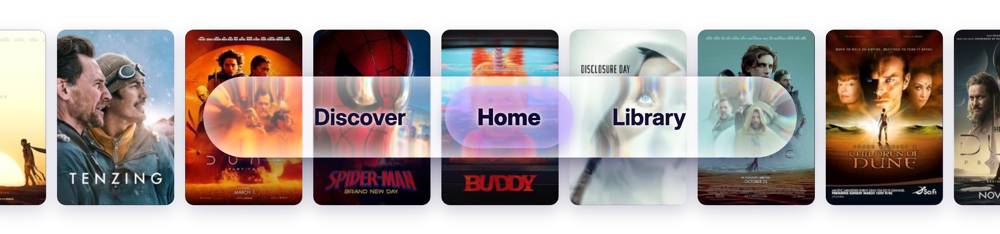
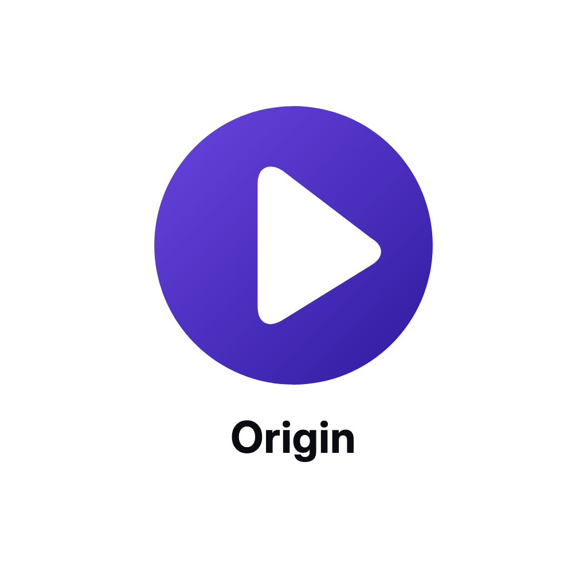

  
  &nbsp;&nbsp;&nbsp;&nbsp;
  

<h1 align="center">Stremio Origin for Samsung TVs</h1>

A native app for Stremio addons, written in C.

<em>Stremio™ is a trademark of its owner. Stremio Origin is independent and unofficial, and is not affiliated with, endorsed by or sponsored by Stremio. Samsung is a trademark of its owner; its logo only shows which platform this is for.</em>

You bring your own Stremio account and your own addons. The app ships empty and plays only the stream links your addons return.

## Features
- Seek previews: a picture of the film on the seek bar, for debrid and direct links
- Trakt: link with a code, scrobbling, rows on Home, watched marks and Continue Watching from Trakt
- Home, Discover, Library and Search, with the addons from your Stremio account
- Film collections in order, in the Library too, and the next film after the credits
- Live TV and sports from your addons, with All channels, Favorites, Recent and a preview as you browse
- The best stream picked in one press, and a sources tray with a tab for each addon
- Styled subtitles as the film made them, with fonts (Arabic too), size, colour, position, brightness and sync
- Forced-only subtitles; each show remembers its subtitles and audio, original language by default
- Chapters, skip intro and recap, and a next-episode card in two sizes
- Auto-play next episode, and a trailer behind Home
- Spoilers blurred for episodes you haven't watched, and upcoming episodes on Home
- A viewer notice as a film starts: an age and its reasons, from IMDb's Parents Guide
- A row for every catalog, with artwork, logos, trailers, people, reviews and ratings
- Titles and descriptions in your language
- Library, watched state and Continue Watching synced with your Stremio account
- Accent colour, a 12 or 24 hour clock and interface sounds
- DTS sound converted on the TV when it can't play it
- Torrents, with an optional USB drive
- Picture size: original, fill or zoom
- The app's own screen saver
- Samsung remotes, the Smart Remote's play and pause key included
- 28 languages, Arabic included (right to left); Share logs from the app

## Install
Turn on Developer Mode on the TV, then install the `.tpk` from [Releases](https://github.com/stremio-origin/tizen/releases) from a computer. [Step by step](docs/install.md).

## Compatibility
One file serves every Samsung TV, through a **very experimental** picker. Tizen 4.0 to 5.5 is supported, developed and tested on Tizen 5.5. On anything else, an error page with a code or a black screen is very likely. [More](docs/compatibility.md).

## Privacy
- Sign-in goes directly to Stremio. Your account stays on the TV.
- No analytics. Nothing is sent to the developer.
- Logs stay on the TV. Sharing them is your choice: Settings > About > Share logs.

## Trakt
Trakt is optional. You link it with a code and the sign-in stays on the TV. While it is linked, what you watch is added to your Trakt history. The app also reads your Trakt name and stats, history, watchlist, recommendations, watched marks and paused positions, only to show them in the app. Unlink any time: Settings > Trakt > Disconnect Trakt.

Stremio Origin uses Trakt but is not endorsed or certified by Trakt.

## Support
-  Support the project / Request a feature: [Ko-fi](https://ko-fi.com/simussu) 
-  [Discord](https://discord.gg/SJEtyV3kW6)
- Report bugs/issues: [stremio-origin/tizen/issues](https://github.com/stremio-origin/tizen/issues)

## Credits
- Interface sounds: [Interface Sounds](https://kenney.nl/assets/interface-sounds) by Kenney (CC0).
- The glass look: [liquid-glass-react](https://github.com/rdev/liquid-glass-react) by rdev; the app ships a modified version.
- Torrents: [Nuvio Engine](https://github.com/NuvioMedia/nuvio-engine) (GPL-3.0); the app ships a modified version.
- The host for 2018 to 2020 TVs: adapted from [Nuvio Legacy](https://github.com/iqui27/nuvio-native-legacy) (GPL-3.0); the app ships a modified version.
- Sound conversion: [FFmpeg](https://ffmpeg.org) (LGPL-2.1).

## Licence
GPL-3.0, see [LICENSE](LICENSE). Third-party components and their licences: [third_party/licenses/README.txt](third_party/licenses/README.txt).

Provided as is, for personal use on devices you own.
